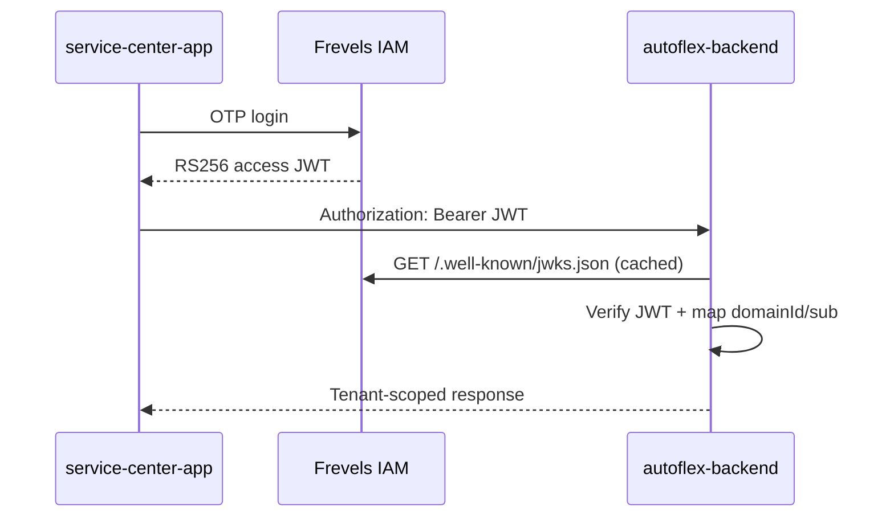

# Autoflex Backend (Phase 0)

NestJS **resource server** for Autoflex. Staff authenticate via **Frevels IAM**; this API verifies RS256 JWTs via JWKS, maps `domainId` → `ServiceCenter` and `sub` → `StaffProfile`, and exposes tenant-scoped business APIs.

Autoflex does **not** issue identity JWTs, handle OTP login, or define RBAC — see [ADR — Frevels IAM Auth](../development-documents/architecture/adr-2026-07-11-frevels-iam-auth.md).

## Prerequisites

- Node.js 18+
- Docker (for local PostgreSQL)
- Frevels IAM running locally (for real JWTs) **or** `LOCAL_JWKS_JSON` for offline/tests

## Durable test workshop

This is the path for the four client apps. Postgres keeps the center, the roster, the customers, and every booking across API restarts. `POST /v1/dev/session` still stands in for Frevels IAM.

```bash
docker compose up -d
cp .env.example .env
npm install
npm run migration:run
npm run catalog:import
npm run services:import
npm run start:workshop
```

`npm run catalog:import` loads the India car catalogue and nothing else. A new car cannot be saved until that import has run. `npm start` does not import it. `npm run start:workshop` still imports the catalogue while it upserts the demo center, staff, and customers.

API: `http://localhost:3001`  
Swagger: `http://localhost:3001/docs`  
Health: `http://localhost:3001/health`

`start:workshop` upserts the roster on boot. `npm run workshop:bootstrap` does the same upsert without starting the API. Rerunning restores the center card, staff, and customer garages. The demo menu is seeded only when the center has no offerings (including soft-deleted rows), so manager edits and pauses survive restart. It does not delete bookings, jobs, or documents. A vehicle's odometer is kept once it has been set.

The first start writes `.workshop/dev-signing-key.json` (gitignored). Dev tokens keep working after a restart until that file is deleted.

Sign in with `POST /v1/dev/session`:

| Who | How |
|-----|-----|
| Apex Auto Garage | The only workshop center (Bengaluru, UPI `apexauto@okhdfcbank`) |
| Meera Iyer, manager | `{"persona":"manager"}` · 9845000001 |
| Arjun Rao, advisor | `{"persona":"advisor"}` · 9845000002 |
| Ravi Kumar, technician | `{"persona":"technician"}` · 9845000003 |
| Sana Sheikh, technician | `{"persona":"technician2"}` · 9845000004 |
| Priya Sharma | `{"phone":"9876543210"}` · Activa `KA01AB1234`, i20 `KA03MN4567` |
| Nikhil Menon | `{"phone":"9845123450"}` · Classic 350 `KA05RE2201` |
| Aisha Khan | `{"phone":"9900887766"}` · Swift `KA02SW4410` |

`npm run start:dev` is the API without the dev-session stand-in, for when Frevels IAM is issuing real tokens. `npm run seed:dev` only maps one IAM domain id and user id; it is not the workshop roster.

### Local memory runtime (no Docker)

```bash
PORT=3001 npm run start:memory
```

Uses pg-mem. It loads the same Apex roster, then adds Speedline, Koramangala, and a scripted morning of jobs. Every restart wipes that database. Boot takes about a minute. Prefer `start:workshop` when bookings should survive.

## Auth flow (verify-only)



### JWT claims used

| IAM claim | Autoflex mapping |
|-----------|------------------|
| `domainId` | `ServiceCenter.iamDomainId` (1:1 Phase 0) |
| `sub` | `StaffProfile.iamUserId` |
| `domainApplicationId` | Client app registration in IAM |
| `roles` / `permissions` | Enforced by guards on routes |

Missing or inactive tenant mapping returns **404** (no cross-tenant leakage).

## Environment variables

| Variable | Required | Description |
|----------|----------|-------------|
| `PORT` | No | HTTP port (default `3001`) |
| `DATABASE_HOST` | Yes | Postgres host |
| `DATABASE_PORT` | Yes | Postgres port |
| `DATABASE_USER` | Yes | Postgres user |
| `DATABASE_PASSWORD` | Yes | Postgres password |
| `DATABASE_NAME` | Yes | Postgres database |
| `IAM_JWKS_URL` | Yes* | IAM JWKS endpoint |
| `JWKS_CACHE_TTL_MS` | No | JWKS cache TTL (default 5m) |
| `IAM_JWT_ISSUER` | No | Optional issuer validation |
| `IAM_JWT_AUDIENCE` | No | Optional audience validation |
| `LOCAL_JWKS_JSON` | No | Inline JWKS for tests/offline only |
| `DATABASE_NAME_TEST` | No | DB name for e2e (default `autoflex_test`) |

\* Not required when `LOCAL_JWKS_JSON` is set (tests/offline).

## Project structure

```
src/
  common/           # Shared enums, DTOs
  database/         # TypeORM data source, migrations, seed
  modules/
    auth/           # JWKS verify, JWT guard, roles/permissions guards
    tenancy/        # ServiceCenter, StaffProfile, domain resolution
    customers/      # Customer, Vehicle entities
    jobs/           # ServiceJob CRUD + status transitions
    events/         # ServiceJobEvent, AuditLog
  test-utils/       # JWT test helpers
test/               # E2E specs + DB helpers
```

## API (Phase 0)

| Method | Path | Auth | Description |
|--------|------|------|-------------|
| `GET` | `/health` | Public | Health check |
| `POST` | `/v1/jobs` | Bearer + `jobs:create` | Create job (token generated internally; omitted from response) |
| `GET` | `/v1/jobs` | Bearer + `jobs:read` | List/filter/paginate jobs |
| `GET` | `/v1/jobs/:id` | Bearer + `jobs:read` | Job detail |
| `PATCH` | `/v1/jobs/:id` | Bearer + `jobs:update` | Update job fields |
| `PATCH` | `/v1/jobs/:id/status` | Bearer + `jobs:update` | Workflow status transition |
| `DELETE` | `/v1/jobs/:id` | Bearer + `jobs:delete` | Soft-delete job |

Job statuses: `CHECKED_IN`, `INSPECTION`, `AWAITING_APPROVAL`, `IN_PROGRESS`, `QUALITY_CHECK`, `READY_FOR_PICKUP`, `COMPLETED`, `ON_HOLD`, `CANCELLED`.

## Scripts

| Command | Description |
|---------|-------------|
| `npm run start:dev` | Dev server with watch (real IAM; no dev session) |
| `npm run start:workshop` | Durable Postgres workshop and `POST /v1/dev/session` |
| `npm run workshop:bootstrap` | Upsert the workshop roster without starting the API |
| `npm run start:memory` | Throwaway pg-mem runtime (resets on exit) |
| `npm run build` | Compile TypeScript |
| `npm run lint` | ESLint |
| `npm test` | Unit tests |
| `npm run test:e2e` | HTTP/policy E2E tests using pg-mem |
| `npm run test:support:postgres` | Opt-in AF-010 migration/transaction tests on disposable PostgreSQL |
| `npm run migration:run` | Apply migrations |
| `npm run migration:revert` | Revert last migration |
| `npm run seed:dev` | Map one IAM domain and user (not the workshop roster) |
| `npm run support:preflight` | Read support status counts and incompatible links before migration |
| `npm run intake:preflight` | Read returning-intake conflict counts without personal identifiers; works before migration 0011 |
| `npm run support:provision` | Provision a support profile for an existing IAM identity |

## Testing

E2E tests use **pg-mem** (in-memory Postgres) — no Docker required for `npm run test:e2e`. For local dev and migration verification, use Docker Postgres:

```bash
docker compose up -d
createdb -h localhost -U autoflex autoflex_test   # optional, only if using a separate test DB against real Postgres
npm test
npm run test:e2e
```

E2E tests use a local RSA keypair (`LOCAL_JWKS_JSON`) — no IAM instance required.

## Related docs

- [Technical Architecture](../development-documents/architecture/technical-architecture.md)
- [Phase 0 Repository Plan](../development-documents/architecture/phase-0-repository-plan.md)
- [ADR — Frevels IAM](../development-documents/architecture/adr-2026-07-11-frevels-iam-auth.md)


## AF-010 central support

Migration `1730000000008` adds the central support queue after the vehicle catalogue. Operators are distinct from customers and center staff; a signed support role/permission and active `support_agent_profiles` mapping are required. Configure `IAM_SUPPORT_DOMAIN_APPLICATION_ID` and `IAM_SUPPORT_DOMAIN_ID` separately from the customer application. Empty configuration disables operator access.

`GET /v1/support/me`, queue/summary/detail/events/roster and explicit command routes power `support-app` (port 5176). Customer conversations are `/v1/me/support-requests/:id/events` and `POST :id/replies`. New commands require `If-Match` and `Idempotency-Key`. Request state, immutable event, receipt and public-action notifications commit together. Customer reads never serialize private notes or operator identities. No SLA/external delivery is promised.

- `npm run support:preflight`: aggregate status and incompatible link report; run and back up the intended target before migrating.
- `npm run support:provision -- --user <IAM-user-id> --name "Display name"`: create a local active mapping in the configured support domain. Existing profiles stay unchanged; provision IAM roles separately.
- Local `workshop:bootstrap` / memory runtime seed named support accounts: `{"actor":"support","phone":"9845000011"}` (Neha), `9845000012` (Kabir), `9845000013` (manager Ananya). Reruns never reactivate disabled support profiles.
- `npm run test:support:postgres`: opt-in transaction/migration suite, fixed disposable `af010_test` database on localhost:55410. It drops that dedicated schema; it never targets the workshop. See the runbook for the disposable Docker command.

[Support runbook](../development-documents/architecture/support-work-queue-runbook.md) · [Current contracts](../development-documents/architecture/api-contracts-v1.md#central-support-work-queue). Real IAM sign-in and production rollout remain separate tracked work.

## AF-001 public tracking

`GET /v1/track/:publicToken` anonymously returns limited status/history, masked registration, ETA and nullable public business `centerPhone`. It excludes note bodies, personal contact details, prices and approval/payment capabilities. Success and controller-error responses use no-store/noindex headers; malformed or unavailable tokens return 404. Completed/cancelled jobs remain readable. No new migration is needed.

The matching customer route is `/t/:token`. Deploy the API privacy/masking changes before or with that website. [Setup, verification and production launch requirements](../development-documents/architecture/public-job-timeline-runbook.md). Focused coverage lives in `test/public-tracking.e2e-spec.ts` and `src/modules/jobs/public-tracking-view.spec.ts`.

### Tracking token replacement (AF-004)

Same-center admin/manager/advisor staff can read `GET /v1/jobs/:id/public-token` with `jobs:read` and replace via `POST /v1/jobs/:id/public-token/rotate` with read/update permission. POST requires strict `If-Match`, `Idempotency-Key` and `{reason}`. Token/version/private audit/non-secret receipt commit together; retries replay the receipt. No notification or public event is written. All non-deleted statuses are allowed. No migration is added.

Run `npm run test:e2e -- --runInBand --testPathPatterns=tracking-token-rotation.e2e` for API coverage. Real transaction tests require the disposable PostgreSQL database named `af004_test` with matching user/password on `127.0.0.1:55404`; then run `AF004_POSTGRES_TEST=true npm run test:e2e -- --runInBand --testPathPatterns=tracking-token-rotation-postgres`. The opt-in suite resets this fixed test database; do not use durable workshop data. [Setup, recovery and rollout runbook](../development-documents/architecture/public-job-timeline-runbook.md#staff-tracking-link-replacement-af-004).

## AF-029 service catalog and packages

Migration `1730000000009` adds the shared activity catalog, versioned menu options, packages, and immutable booking/job scope. Run `npm run services:import` after migrations to import the initial 12 activities. This is separate from the vehicle `catalog:import`; it creates no centers, staff, customers or prices. Neither catalog is loaded by `npm start`. Workshop startup then links two exact, reviewed Apex demo services to their catalog activities without changing their prices; other existing offerings remain unmapped until a manager reviews them.

Admins/managers with `center:manage` configure the menu in the desk's **Services & packages** screen. Menu writes require an explicit `Idempotency-Key`; edits/removal also require `If-Match`. Shared catalog identity, exact service filtering, typed booking selections and package contents are documented in the [contracts](../development-documents/architecture/api-contracts-v1.md) and [runbook](../development-documents/architecture/service-marketplace-runbook.md).

PostgreSQL integration verification uses the isolated fixed target on port 55429, never the normal workshop environment. See the runbook before running `AF029_POSTGRES_TEST=true npm run test:e2e -- --runInBand --testPathPatterns=service-marketplace`.

### Customer discovery location

`GET /v1/marketplace/discovery-config` returns the user-approved Bengaluru fallback and the 15 km GPS radius. Optional `DISCOVERY_DEFAULT_CITY`/`DISCOVERY_DEFAULT_LABEL` override it. Missing/blank city uses Bengaluru; invalid nonblank configuration returns `defaultLocation:null`.

`GET /v1/marketplace/available-services` requires city, exact `postalCode`, or paired coordinates and returns paginated services actually offered in the whole eligible area. PIN may combine with coordinates/radius; city+PIN is rejected. Center search shares the predicates and accepts coordinate-only `nearest`/`farthest` sorts. Distances are straight-line, not travel estimates. The manager's master catalog stays global. Profile location writes require bounded numeric pairs or paired null clearing and can clear postal/state metadata.

`GET /v1/marketplace/postal-locations/:postalCode` resolves a six-digit PIN through the third-party PostalPinCode directory into localities/district/state. The adapter has a five-second timeout, bounded success/not-found cache and request sharing. No coordinates or customer identity are sent/inferred. The customer picker offers PIN lookup or explicit browser location; failures preserve the current area and allow PIN retry, GPS or Skip recovery. City mode remains for configured defaults and saved history.

Migration **1730000000010** adds center gallery `photo_urls` and `google_maps_url`; run migrations before restarting. The desk **More → Location and photos** editor is admin/manager + `center:manage`. It loads the full center profile and PATCHes explicit fields, accepting paired coordinate clears and up to eight gallery URLs. Maps links are validated and displayed, never scraped for coordinates. Existing menus/bookings are preserved. [PIN, distance and gallery delivery](../development-documents/architecture/af-029-pin-distance-gallery-delivery.md).

## Returning-customer intake (AF-006)

Run `npm run intake:preflight`, then migrations before restarting the API. Migration **1730000000011** adds center customer/vehicle canonical keys, revisions and nullable vehicle type, preserving legacy conflicts and unknown types. Preflight reports counts read-only; it never merges, transfers or deletes records.

Desk intake now uses protected exact customer lookup, explicit confirmation and saved vehicle selection. `POST /v1/jobs` requires selected IDs/revisions and one stable `Idempotency-Key`; it returns only `{id,jobNumber,status}`. Vehicle/job/event/audit/receipt commit together. Booking check-in attaches its job atomically and recovers a lost response through that attached job. Backend association, archive/type and active-job checks apply independently of the UI.

New/unlinked reception registration, VAHAN RC verification and global ownership claims/transfers remain pending. A stored association is not verified legal ownership. [Runbook and recovery](../development-documents/architecture/returning-walk-in-runbook.md) · [Live blockers](../development-documents/architecture/af-006-returning-customer-walk-in-scope.md#13-live-execution-status-and-blockers--12-october-2026) · [Isolated regression instructions](./test/AF006.md).

### Working hours and booking slots (AF-009)

After migrations, run `npm run schedule:preflight` before enabling booking traffic in a new environment. This reads existing center schedules and future commitments without changing them. Migration `1730000000012` preserves legacy hours/bookings and defaults to zero advance notice and seven India calendar dates including today. Managers edit **More → Working hours & booking slots** in the desk app.

Backend and customer enforce exact hourly arrival windows, holidays/breaks, notice, horizon and capacity. Schedule commands require a revision and idempotency key; customer booking keys are committed in the same transaction as the reservation. Existing visits are retained when hours/capacity change. Use PostgreSQL for transaction/rollback verification. See [AF-009 test guide](test/AF009.md); `npm run test:scheduling:postgres` targets the isolated test database documented there.
