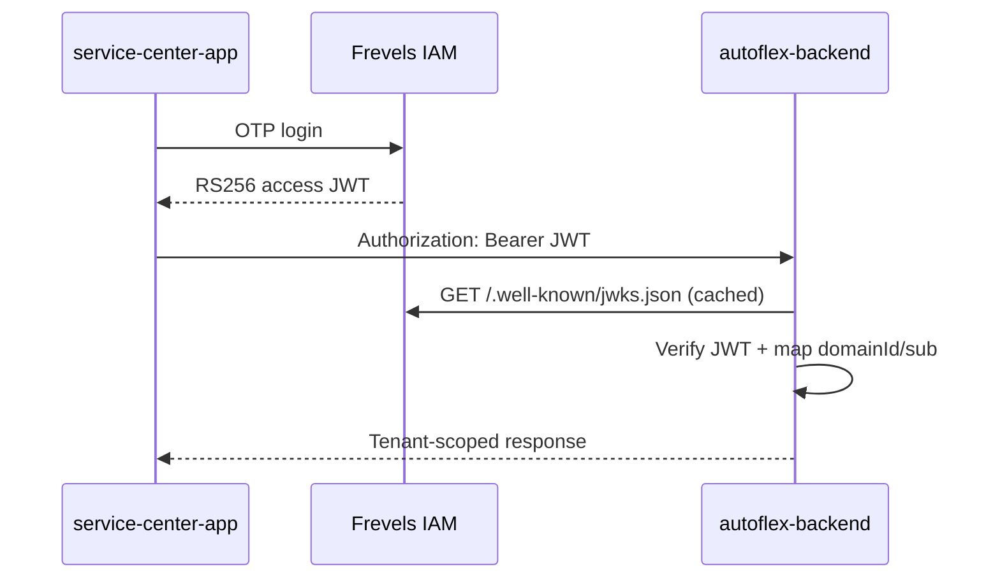

# Autoflex Backend (Phase 0)

NestJS **resource server** for Autoflex. Staff authenticate via **Frevels IAM**; this API verifies RS256 JWTs via JWKS, maps `domainId` → `ServiceCenter` and `sub` → `StaffProfile`, and exposes tenant-scoped business APIs.

Autoflex does **not** issue identity JWTs, handle OTP login, or define RBAC — see [ADR — Frevels IAM Auth](../development-documents/architecture/adr-2026-07-11-frevels-iam-auth.md).

## Prerequisites

- Node.js 18+
- Docker (for local PostgreSQL)
- Frevels IAM running locally (for real JWTs) **or** `LOCAL_JWKS_JSON` for offline/tests

## Quick start

```bash
# 1. Start PostgreSQL
docker compose up -d

# 2. Configure environment
cp .env.example .env

# 3. Install dependencies
npm install

# 4. Run migrations
npm run migration:run

# 5. Seed demo tenant mapping (ServiceCenter + StaffProfile)
npm run seed:dev

# 6. Start API
npm run start:dev
```

API: `http://localhost:3001`  
Swagger: `http://localhost:3001/docs`  
Health: `http://localhost:3001/health`

### Local memory runtime (no Docker)

```bash
PORT=3001 npm run start:memory
```

Uses pg-mem, seeds Apex / Speedline / Koramangala plus Priya's garage, and exposes `POST /v1/dev/session` for staff personas (`manager`, `advisor`, `technician`, `technician2`) and customer phones. Swagger is at `/docs`. Boot takes about a minute.

## Auth flow (verify-only)



### JWT claims used

| IAM claim | Autoflex mapping |
|-----------|------------------|
| `domainId` | `ServiceCenter.iamDomainId` (1:1 Phase 0) |
| `sub` | `StaffProfile.iamUserId` |
| `domainApplicationId` | Client app registration in IAM |
| `roles` / `permissions` | Enforced by guards on routes |

Missing or inactive tenant mapping returns **404** (no cross-tenant leakage).

## Environment variables

| Variable | Required | Description |
|----------|----------|-------------|
| `PORT` | No | HTTP port (default `3001`) |
| `DATABASE_HOST` | Yes | Postgres host |
| `DATABASE_PORT` | Yes | Postgres port |
| `DATABASE_USER` | Yes | Postgres user |
| `DATABASE_PASSWORD` | Yes | Postgres password |
| `DATABASE_NAME` | Yes | Postgres database |
| `IAM_JWKS_URL` | Yes* | IAM JWKS endpoint |
| `JWKS_CACHE_TTL_MS` | No | JWKS cache TTL (default 5m) |
| `IAM_JWT_ISSUER` | No | Optional issuer validation |
| `IAM_JWT_AUDIENCE` | No | Optional audience validation |
| `LOCAL_JWKS_JSON` | No | Inline JWKS for tests/offline only |
| `DATABASE_NAME_TEST` | No | DB name for e2e (default `autoflex_test`) |

\* Not required when `LOCAL_JWKS_JSON` is set (tests/offline).

## Project structure

```
src/
  common/           # Shared enums, DTOs
  database/         # TypeORM data source, migrations, seed
  modules/
    auth/           # JWKS verify, JWT guard, roles/permissions guards
    tenancy/        # ServiceCenter, StaffProfile, domain resolution
    customers/      # Customer, Vehicle entities
    jobs/           # ServiceJob CRUD + status transitions
    events/         # ServiceJobEvent, AuditLog
  test-utils/       # JWT test helpers
test/               # E2E specs + DB helpers
```

## API (Phase 0)

| Method | Path | Auth | Description |
|--------|------|------|-------------|
| `GET` | `/health` | Public | Health check |
| `POST` | `/v1/jobs` | Bearer + `jobs:create` | Create job (generates `publicToken`) |
| `GET` | `/v1/jobs` | Bearer + `jobs:read` | List/filter/paginate jobs |
| `GET` | `/v1/jobs/:id` | Bearer + `jobs:read` | Job detail |
| `PATCH` | `/v1/jobs/:id` | Bearer + `jobs:update` | Update job fields |
| `PATCH` | `/v1/jobs/:id/status` | Bearer + `jobs:update` | Workflow status transition |
| `DELETE` | `/v1/jobs/:id` | Bearer + `jobs:delete` | Soft-delete job |

Job statuses: `CHECKED_IN`, `INSPECTION`, `AWAITING_APPROVAL`, `IN_PROGRESS`, `QUALITY_CHECK`, `READY_FOR_PICKUP`, `COMPLETED`, `ON_HOLD`, `CANCELLED`.

## Scripts

| Command | Description |
|---------|-------------|
| `npm run start:dev` | Dev server with watch |
| `npm run build` | Compile TypeScript |
| `npm run lint` | ESLint |
| `npm test` | Unit tests |
| `npm run test:e2e` | E2E tests (requires Postgres) |
| `npm run migration:run` | Apply migrations |
| `npm run migration:revert` | Revert last migration |
| `npm run seed:dev` | Seed demo ServiceCenter + StaffProfile |

## Testing

E2E tests use **pg-mem** (in-memory Postgres) — no Docker required for `npm run test:e2e`. For local dev and migration verification, use Docker Postgres:

```bash
docker compose up -d
createdb -h localhost -U autoflex autoflex_test   # optional, only if using a separate test DB against real Postgres
npm test
npm run test:e2e
```

E2E tests use a local RSA keypair (`LOCAL_JWKS_JSON`) — no IAM instance required.

## Related docs

- [Technical Architecture](../development-documents/architecture/technical-architecture.md)
- [Phase 0 Repository Plan](../development-documents/architecture/phase-0-repository-plan.md)
- [ADR — Frevels IAM](../development-documents/architecture/adr-2026-07-11-frevels-iam-auth.md)
